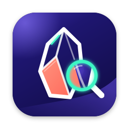
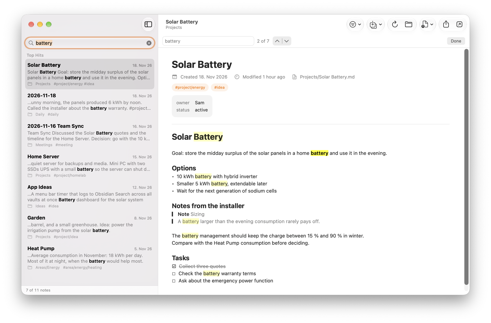

<p align="center">
  
</p>

<h1 align="center">VaultSearch</h1>

<p align="center">
  A native Mac app that searches your Obsidian vault as you type, and exports what it finds.<br>
  <a href="docs/user-guide.md">User Guide</a> ·
  <a href="docs/benutzerhandbuch.md">Benutzerhandbuch (Deutsch)</a> ·
  <a href="docs/automation.md">Automation</a> ·
  <a href="docs/development.md">Developer Guide</a>
</p>

---

<p align="center">
  
</p>

VaultSearch reads the Markdown notes of an [Obsidian](https://obsidian.md) vault into a local index and searches them instantly by text, tag, frontmatter property or date. It is a companion to Obsidian, not a replacement: every hit opens in Obsidian with one keystroke. Your notes never leave your Mac.

## Features

- **Search as you type.** Results update while you type, ignore case and accents, and show the matching passage.
- **Tags, properties and dates.** `tag:idea` also finds nested tags such as `project/idea`, ranked by closeness. Filter by any frontmatter property (`status:active`) or by date (`modified:last 7 days`, `erstellt:diese Woche`).
- **AND / OR.** Spaces combine terms; `OR` separates alternatives, as in Obsidian.
- **Preview with find.** The preview jumps to the first match and steps through all of them (⌘G / ⇧⌘G).
- **Export.**
  - Save a result list as a Markdown note in your vault, with links or embedded notes.
  - Export single notes or result lists as PDF, Word, OpenDocument, RTF, HTML, EPUB or Markdown.
  - Pandoc is used when it is installed, otherwise the conversion built into macOS. Templates are supported.
- **Shortcuts, Spotlight, Siri and AppleScript.** Find, filter and export notes in Shortcuts and start your shortcuts with Siri, search your notes in Spotlight, or script VaultSearch with AppleScript.
- **A Mac app.** It has a native sidebar and search field, menus with keyboard shortcuts, a Settings window and VoiceOver labels. The interface is in English and German.

## Requirements

- macOS 27 or later
- An Obsidian vault (any folder of Markdown files works)
- Optional, for more export formats and better typesetting: [Pandoc](https://pandoc.org) and a PDF engine, e.g. `brew install pandoc`

## Installation

VaultSearch is built from source:

```sh
git clone https://github.com/iLeif-de/VaultSearch.git
cd VaultSearch
open VaultSearch.xcodeproj
```

In Xcode choose **Product ▸ Run** (⌘R), or **Product ▸ Archive** for a release build. Xcode 27 or later is required. When it starts, choose your vault folder.

**Product ▸ Test** (⌘U) runs the unit tests. To try the app without your own notes, choose the sample vault in [`docs/demo-vault`](docs/demo-vault).

## Search at a glance

| You type | VaultSearch finds |
|---|---|
| `budget meeting` | notes containing both words |
| `"budget meeting"` | the exact phrase |
| `budget OR tag:finance` | either |
| `tag:idea` | tag `idea`, then `idea/…`, then `…/idea` |
| `contenttag:idea` | `#idea`, `#project/idea` or `[[idea]]` in the text |
| `status:active` | frontmatter property containing the value |
| `created:2025-04-28`, `created:28.04.25` | notes created on that day |
| `modified:>=2025-04-01` | modified on or after (also `>`, `<=`, `<`) |
| `modified:this week`, `created:last 30 days` | relative dates (German: `geändert:diese Woche`, `erstellt:letzte 30 Tage`) |

The full syntax is in the [User Guide](docs/user-guide.md#search-syntax) and under **Help ▸ Search Syntax** in the app.

## Documentation

- [User Guide](docs/user-guide.md): using the app, search syntax, export, settings, troubleshooting
- [Benutzerhandbuch](docs/benutzerhandbuch.md): the same in German
- [Automating VaultSearch](docs/automation.md) / [VaultSearch automatisieren](docs/automatisierung.md): Siri, Shortcuts and AppleScript, with examples
- [Developer Guide](docs/development.md): architecture, code tour, localisation, icons, building

## License

VaultSearch is released under the [MIT License](LICENSE).

VaultSearch is an independent project and is not affiliated with or endorsed by Obsidian.
