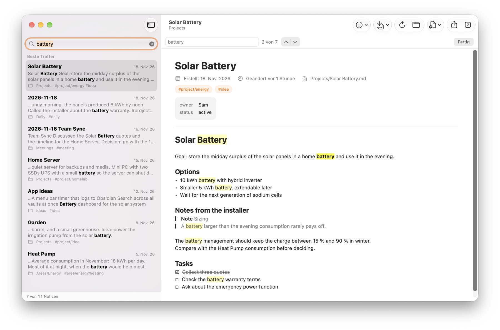
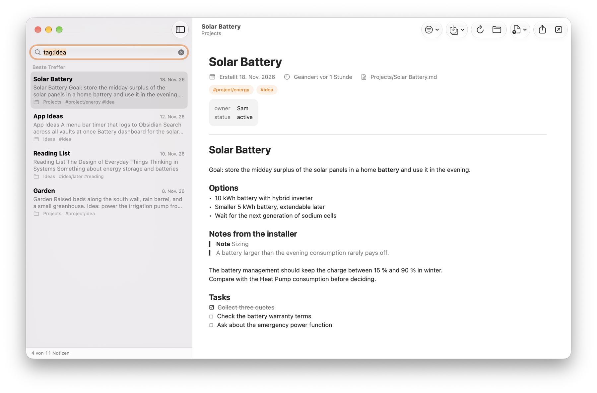
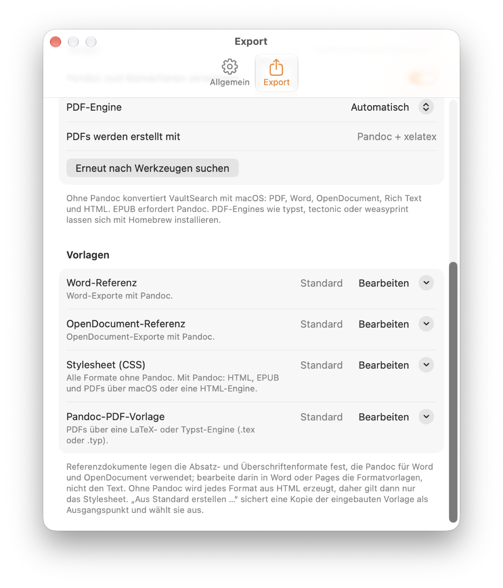
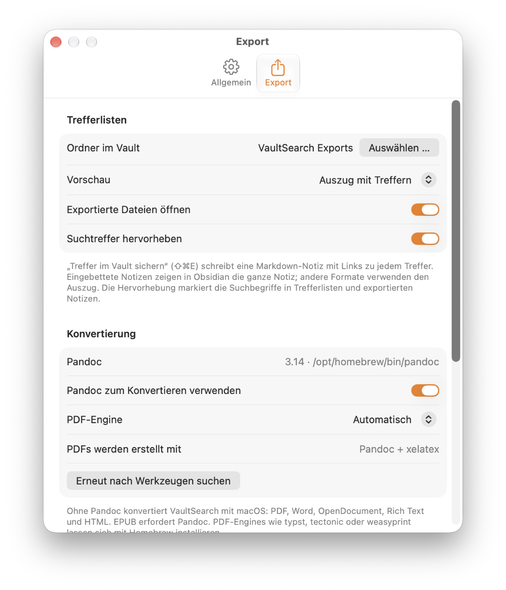

# VaultSearch Benutzerhandbuch

*English: [User Guide](user-guide.md)*

VaultSearch durchsucht die Markdown-Notizen eines Obsidian-Vaults schon beim Tippen und exportiert, was es findet. Dieses Handbuch beschreibt alles, was die App kann.

- [Erste Schritte](#erste-schritte)
- [Das Fenster](#das-fenster)
- [Suchsyntax](#suchsyntax)
- [Die Fundstelle in der Notiz finden](#die-fundstelle-in-der-notiz-finden)
- [Mit Notizen arbeiten](#mit-notizen-arbeiten)
- [Export](#export)
- [Siri, Kurzbefehle und Spotlight](#siri-kurzbefehle-und-spotlight)
- [Einstellungen](#einstellungen)
- [Tastaturkurzbefehle](#tastaturkurzbefehle)
- [Fehlerbehebung](#fehlerbehebung)
- [Datenschutz](#datenschutz)

## Erste Schritte

1. Öffne VaultSearch.
2. Klicke auf **Vault auswählen …** und wähle den Ordner deines Obsidian-Vaults. Ändern kannst du ihn später über **Ablage ▸ Vault auswählen …** (⌘O) oder in den Einstellungen.
3. VaultSearch liest alle Notizen ein. Bei großen Vaults dauert das einige Sekunden; der Fortschritt erscheint in der Seitenleiste.
4. Beginne zu tippen.

VaultSearch hält den Index selbst aktuell. Alle 30 Sekunden und jedes Mal, wenn du zur App zurückkehrst, prüft es auf Änderungen. **Darstellung ▸ Vault neu indizieren** (⌘R) liest alles neu ein.

Übersprungen werden:

- versteckte Ordner wie `.obsidian` und `.trash`,
- die in den Einstellungen ausgeschlossenen Ordner,
- der Exportordner für Trefferlisten.

## Das Fenster



| Bereich | Inhalt |
|---|---|
| **Suchfeld** (oben in der Seitenleiste) | Deine Suche. ⌘F springt von überall dorthin. |
| **Trefferliste** | Passende Notizen: Titel, Datum, Ordner, Tags und die Textstelle mit dem Treffer. Bei leerem Suchfeld stehen hier die 100 zuletzt geänderten Notizen. |
| **Statuszeile** (unter der Liste) | Anzahl der Treffer, Fortschritt beim Indizieren oder Exportieren. |
| **Vorschau** (rechts) | Die ausgewählte Notiz mit Metadaten, Tags und Eigenschaften. Suchbegriffe sind hervorgehoben. |
| **Symbolleiste** | Filter-Menü, Export-Menü, Neu indizieren; über der Vorschau: Im Finder anzeigen, Notiz exportieren, Teilen, In Obsidian öffnen. |

Die Treffer sind in dieser Reihenfolge sortiert:

1. Nähe der Tag-Treffer (siehe `tag:` unten),
2. Notizen, deren Titel ein Suchwort enthält,
3. zuletzt geändert.

Mit ↩ im Suchfeld wählst du den ersten Treffer aus. Mit den Pfeiltasten bewegst du dich durch die Liste. Ein Doppelklick oder ⌘↩ öffnet die Notiz in Obsidian.

Beim Tippen schlägt das Suchfeld Operatoren, deine Tags, deine Frontmatter-Eigenschaften und Datumsangaben vor. Ein Klick auf einen Vorschlag ergänzt ihn.

## Suchsyntax

Groß-/Kleinschreibung und Akzente spielen beim Textvergleich keine Rolle, `cafe` findet also „Café“.

### Text

| Suche | Findet Notizen, … |
|---|---|
| `budget` | deren Titel oder Text „budget“ enthält |
| `budget besprechung` | die **beide** Wörter enthalten, egal wo |
| `"budget besprechung"` | die genau diese Wortfolge enthalten |

Normaler Text durchsucht **keine** Tags. Dafür gibt es `tag:`; beides lässt sich mit `ODER` verbinden.

### UND und ODER

Durch Leerzeichen getrennte Begriffe müssen **alle** zutreffen. `ODER` (oder `OR`) trennt Alternativen. Das funktioniert genauso wie in Obsidian:

```
tag:projekt budget ODER tag:idee
```

bedeutet *(Tag projekt UND enthält budget) ODER Tag idee*.

- `UND` (oder `AND`) kannst du ausschreiben, es ist aber ohnehin der Standard.
- Operatoren müssen **großgeschrieben** sein. Ein kleingeschriebenes „oder“ bleibt ein normales Suchwort.

### Tags

Tags stammen aus dem Feld `tags` im Frontmatter, als Liste (`- idee`) oder in einer Zeile (`tags: [idee, projekt]`).

| Suche | Findet |
|---|---|
| `tag:idee` | den Tag auf jeder Ebene der Hierarchie |
| `tag:projekt/idee` | genau diesen Pfad, auch tiefer (`bereich/projekt/idee`) |



Die Treffer sind nach Nähe sortiert:

1. `idee`, der Tag selbst
2. `idee/später`, ein Untertag
3. `projekt/idee`, `bereich/projekt/idee`, der Tag tiefer in der Hierarchie

`tag:` vergleicht ganze Ebenen: `tag:idee` findet also nicht `ideen`. Ein vorangestelltes `#` ist erlaubt.

Tags im Notiztext (`#idee`) findest du mit `contenttag:`:

| Suche | Findet im Text |
|---|---|
| `contenttag:idee` | `#idee`, `#idee/später`, `#projekt/idee` oder einen Link `[[idee]]`, aber nicht `#ideen` |

### Eigenschaften

`schlüssel:wert` findet Notizen, deren Frontmatter-Eigenschaft *schlüssel* den *wert* enthält. Groß-/Kleinschreibung des Schlüssels ist egal; die Notiz muss die Eigenschaft besitzen.

```
status:aktiv
importance:high
quelle:podcast
```

### Datum

`erstellt:` bezieht sich auf das Erstellungsdatum der Datei und `geändert:` (auch `geaendert:`) auf die letzte Änderung. Die englischen Formen `created:` und `modified:` funktionieren ebenso.

| Wert | Bedeutung |
|---|---|
| `2025-04-28`, `28.04.25`, `28.04.2025` | dieser Tag |
| `heute`, `gestern` | |
| `diese Woche`, `dieser Monat`, `dieses Jahr` | vom Beginn des Zeitraums bis heute |
| `letzte Woche`, `letzter Monat`, `letztes Jahr` | die vorherige Kalenderwoche, der vorherige Monat bzw. das vorherige Jahr |
| `letzte 7 Tage`, `letzte 2 Wochen`, `letzte 3 Monate`, `letztes 1 Jahr` | fortlaufender Zeitraum bis heute |

Englische Angaben gehen ebenfalls: `today`, `this week`, `last month`, `last 7 days` …

Mit einem vorangestellten Operator gibst du offene Zeiträume an: `>=`, `>`, `<=`, `<`.

```
geändert:>=2025-04-01 geändert:<=2025-04-30
erstellt:letzte 30 Tage tag:idee
```

Das **Filter**-Menü in der Symbolleiste fügt gängige Datumsfilter und deine häufigsten Tags mit einem Klick ein. **Eigener Zeitraum …** erstellt einen Datumsfilter über einen Kalender. Bei deutscher Oberfläche setzen beide die deutschen Begriffe ein.

**Hilfe ▸ Suchsyntax** (⌘?) zeigt eine Kurzübersicht in der App.

## Die Fundstelle in der Notiz finden

Wenn du eine Notiz auswählst, springt die Vorschau zum ersten Treffer und zeigt über der Notiz eine Suchleiste:

- **3 von 12** zeigt, welcher Treffer gerade aktiv ist. Er ist in der Suchfarbe des Systems hervorgehoben, die übrigen heller.
- **↩** (oder ⌘G) springt zum nächsten Treffer, **⇧↩** (oder ⇧⌘G) zum vorherigen. Die Pfeiltasten in der Leiste tun dasselbe.
- Tippst du etwas in die Suchleiste, wird nur in dieser Notiz danach gesucht (**Bearbeiten ▸ In Notiz suchen**, ⌥⌘F). Leerst du das Feld, gelten wieder die Suchbegriffe.
- **Fertig** oder Esc schließt die Suchleiste.

## Mit Notizen arbeiten

Das Menü **Notiz**, das Kontextmenü der Trefferliste und die Symbolleiste der Vorschau bieten:

| Befehl | Kurzbefehl |
|---|---|
| In Obsidian öffnen | ⌘↩ oder Doppelklick |
| Mit Standard-App öffnen | ⌥⌘↩ |
| Im Finder anzeigen | ⌥⌘R |
| Obsidian-Link kopieren (`obsidian://…`) | ⇧⌘C |
| Pfad kopieren | ⌥⇧⌘C |
| Notiz exportieren als ▸ … | |
| Teilen | |

Ein Klick auf einen Tag in der Vorschau sucht nach diesem Tag.

## Export

### Treffer im Vault sichern

**Ablage ▸ Treffer im Vault sichern** (⇧⌘E) schreibt die aktuelle Trefferliste als Markdown-Notiz in den Exportordner deines Vaults. Standard ist `VaultSearch Exports`.

Die Notiz enthält:

- Frontmatter (Suche, Datum, Anzahl der Treffer und den Tag `#vaultsearch`),
- eine Überschrift,
- je Treffer: einen Link `[[…]]`, Ordner, Datum und Tags sowie eine Vorschau.

Die Vorschau wählst du unter Einstellungen ▸ Export:

| Vorschau | Zeigt |
|---|---|
| Auszug mit Treffern | die Textstelle rund um den Treffer; bei eingeschalteter Hervorhebung sind die Suchwörter `==so==` markiert |
| Eingebettete Notiz (Obsidian) | `![[notiz]]`; Obsidian zeigt die ganze Notiz direkt an |
| Nur Links | nur die Links |

Ist **Exportierte Dateien öffnen** eingeschaltet, öffnet sich die neue Notiz in Obsidian. Der Exportordner selbst wird nie durchsucht, damit frühere Exporte nicht als Treffer erscheinen.

### Als Datei exportieren

**Ablage ▸ Treffer exportieren als ▸ …** exportiert die Trefferliste, **Notiz exportieren als ▸ …** die ausgewählte Notiz. Wähle Format und Speicherort.

| Format | Mit Pandoc | Ohne Pandoc |
|---|---|---|
| PDF | ✓ über die gewählte PDF-Engine | ✓ |
| Word (.docx) | ✓ | ✓ |
| OpenDocument (.odt) | ✓ | ✓ |
| Rich Text (.rtf) | ✓ | ✓ |
| Webseite (.html) | ✓ mit eingebetteten Bildern | ✓ |
| EPUB | ✓ | – |
| Markdown | ✓ Originaldatei | ✓ Originaldatei |

Vor dem Konvertieren macht VaultSearch aus der Obsidian-Syntax portables Markdown:

- `[[Links]]` werden zu Text,
- `![[bild.png]]` wird im ganzen Vault gesucht und eingebunden,
- `%%Kommentare%%` fallen weg,
- Callouts werden zu fetten Beschriftungen,
- `==Markierungen==` bleiben erhalten.

**Suchtreffer hervorheben** (standardmäßig an) markiert die aktuellen Suchbegriffe in exportierten Notizen und Trefferlisten. Exportierst du aus der Vorschau, während du in der Notiz suchst, wird der Text der Suchleiste markiert. Code, Link-Ziele, URLs und `[[Links]]` werden nie verändert.

So sieht die Hervorhebung je nach Format aus:

- **HTML, PDF über macOS, ODT, RTF, EPUB:** farbiger Hintergrund.
- **Word über Pandoc:** Word-Hervorhebung.
- **Word über macOS:** fett und unterstrichen, weil macOS keine Hintergrundfarben in Word-Dateien schreiben kann.
- **PDF über LaTeX:** fett.

### Pandoc oder macOS?

Ohne Pandoc erzeugt VaultSearch aus der Notiz HTML mit dem Stylesheet und lässt macOS daraus die Datei erstellen. Das funktioniert für alles außer EPUB.

Ist Pandoc installiert und **Pandoc zum Konvertieren verwenden** eingeschaltet, übernimmt Pandoc die Konvertierung. Das liefert bessere Word- und OpenDocument-Dateien, unterstützt Vorlagen und kann PDFs mit LaTeX, Typst oder einer HTML-Engine setzen.

**PDF-Engine** in den Einstellungen:

- **Automatisch** nimmt die erste verfügbare Engine in dieser Reihenfolge: weasyprint, typst, tectonic, xelatex, lualatex, pdflatex, wkhtmltopdf, prince. Scheitert sie, etwa weil ein LaTeX-Paket fehlt, wechselt VaultSearch still zu Pandoc + macOS.
- **macOS (ohne Pandoc)** lässt Pandoc HTML erzeugen und macOS daraus ein PDF machen.
- **Eine bestimmte Engine** wird immer verwendet. Ihre Fehler werden gemeldet, statt auszuweichen.

In den Einstellungen siehst du unter **PDFs werden erstellt mit**, welcher Weg aktiv ist.

### Vorlagen

Welche Vorlage gilt, hängt vom Weg ab:

| Export | Verwendet |
|---|---|
| jedes Format **ohne** Pandoc | Stylesheet (CSS) |
| Pandoc → Word | Word-Referenzdokument |
| Pandoc → OpenDocument | OpenDocument-Referenzdokument |
| Pandoc → HTML, EPUB | Stylesheet |
| Pandoc → PDF über macOS oder eine HTML-Engine (prince, weasyprint) | Stylesheet |
| Pandoc → PDF über LaTeX oder Typst | Pandoc-PDF-Vorlage (`.tex` / `.typ`) |



Unter Einstellungen ▸ Export ▸ Vorlagen steht bei jeder Vorlage, wofür sie gilt. Hat eine Vorlage mit den aktuellen Einstellungen keine Wirkung, erscheint der Grund in Orange, etwa *Nicht verwendet: Pandoc ist ausgeschaltet*. Exportierst du mit einer Vorlage, die nicht angewendet werden kann, weist VaultSearch einmal pro Sitzung darauf hin.

Das Menü **Bearbeiten** jeder Vorlage bietet:

- **Datei auswählen …**, um eine eigene Datei zu verwenden.
- **Aus Standard erstellen …**, um eine Kopie der eingebauten Vorlage als Ausgangspunkt zu sichern und auszuwählen:
  - **Word-/OpenDocument-Referenz:** Pandocs Standard-Referenzdokument (benötigt Pandoc). Öffne es in Word oder Pages und ändere die **Formatvorlagen** (Standard, Überschrift 1 …), nicht den Text. Pandoc übernimmt diese Formate in jeden Export.
  - **Stylesheet:** eine Kopie des eingebauten CSS in den VaultSearch-Farben.
- **Im Finder anzeigen**.
- **×** kehrt zur eingebauten Standardvorlage zurück.

Ohne Pandoc entstehen Word-Dateien aus HTML; Schrift, Größen und Farben für Word kommen dann aus dem Stylesheet. macOS übernimmt dabei nur einen Teil des CSS, Hintergrundfarben zum Beispiel nicht.

## Siri, Kurzbefehle und Spotlight

VaultSearch stellt seine Notizen und Aktionen macOS zur Verfügung. So kannst du sie nutzen, ohne das Fenster zu öffnen.

**Siri.** Frag in deinen eigenen Worten, zum Beispiel „Zeig mir meine Notizen zum Budget-Meeting in VaultSearch“ oder „Exportier diese Notiz als PDF“. Solange eine Notiz in der Vorschau zu sehen ist, weiß Siri, welche Notiz mit „diese“ gemeint ist.

**Spotlight.** Nach dem ersten Einlesen erscheinen die Notizen deines Vaults auch in Spotlight. Wählst du eine aus, öffnet sie sich in Obsidian.

**Kurzbefehle.** Die Kurzbefehle-App zeigt unter VaultSearch diese Aktionen:

| Aktion | Was sie macht |
|---|---|
| **Notizen finden** | Gibt die Notizen zurück, die zu einer Suche passen. Es gilt dieselbe Suchsyntax wie im Suchfeld. |
| **In VaultSearch suchen** | Zeigt die Ergebnisse einer Suche im Fenster. |
| **Notiz in Obsidian öffnen** | Öffnet eine Notiz. |
| **Suchergebnisse im Vault sichern** | Sichert die Ergebnisse als Notiz im Exportordner, wie **Treffer im Vault sichern**. |
| **Suchergebnisse exportieren** | Erstellt aus den Ergebnissen ein Dokument (PDF, Word, …). |
| **Notiz exportieren** | Erstellt aus einer Notiz ein Dokument. |

Die Export-Aktionen geben die Datei an die nächste Aktion weiter, zum Beispiel **Datei sichern** oder **Teilen**. Sie verwenden deine Einstellungen unter Einstellungen ▸ Export, einschließlich Pandoc und Vorlagen.

Läuft VaultSearch nicht, startet macOS die App. Die erste Anfrage wartet dann, bis der Vault eingelesen ist.

## Einstellungen

Öffnen mit **VaultSearch ▸ Einstellungen …** (⌘,).

**Allgemein**

- **Vault: Ordner**: der zu durchsuchende Vault. Damit „In Obsidian öffnen“ funktioniert, muss der Ordnername dem Vault-Namen in Obsidian entsprechen.
- **Index**: Anzahl der Notizen und Zeit der letzten Aktualisierung; **Jetzt neu indizieren**.
- **Ausgeschlossene Ordner**: Notizen darin werden nicht durchsucht. Hinzufügen mit **Ordner hinzufügen …**, entfernen mit ⊖.

**Export**



- **Trefferlisten**
  - **Ordner im Vault**: wohin Trefferlisten gesichert werden.
  - **Vorschau**: was jeder Treffer in einer Trefferliste zeigt.
  - **Exportierte Dateien öffnen**: jeden Export nach dem Erstellen öffnen.
  - **Suchtreffer hervorheben**: Suchbegriffe in Exporten markieren.
- **Konvertierung**
  - **Pandoc**: ob Pandoc gefunden wurde. Falls nicht, kopiert **Installationsbefehl kopieren** `brew install pandoc`.
  - **Pandoc zum Konvertieren verwenden**.
  - **PDF-Engine** und **PDFs werden erstellt mit**.
  - **Erneut nach Werkzeugen suchen**: nach der Installation von Pandoc oder einer Engine erneut suchen.
- **Vorlagen**: siehe [Vorlagen](#vorlagen).

## Tastaturkurzbefehle

| Kurzbefehl | Befehl |
|---|---|
| ⌘F | Vault durchsuchen (Suchfeld aktivieren) |
| ↩ im Suchfeld | Ersten Treffer auswählen |
| ⌥⌘F | In Notiz suchen |
| ⌘G / ⇧⌘G | Nächster / vorheriger Treffer in der Notiz |
| ⌘↩ | In Obsidian öffnen |
| ⌥⌘↩ | Mit Standard-App öffnen |
| ⌥⌘R | Im Finder anzeigen |
| ⇧⌘C | Obsidian-Link kopieren |
| ⌥⇧⌘C | Pfad kopieren |
| ⇧⌘E | Treffer im Vault sichern |
| ⌘O | Vault auswählen … |
| ⌘R | Vault neu indizieren |
| ⌃⌘S | Seitenleiste ein-/ausblenden |
| ⌘, | Einstellungen |
| ⌘? | Suchsyntax |

## Fehlerbehebung

**„In Obsidian öffnen“ öffnet den falschen Vault oder gar nichts.**
VaultSearch verwendet den Ordnernamen als Vault-Namen. Achte darauf, dass der Vault in Obsidian genauso heißt wie sein Ordner.

**Eine gerade erstellte Notiz fehlt.**
Der Index aktualisiert sich alle 30 Sekunden und beim Zurückkehren zur App. ⌘R indiziert sofort neu.

**Pandoc ist installiert, aber es wird „Nicht installiert“ angezeigt.**
Apps sehen den `PATH` deiner Shell nicht. VaultSearch sucht in `/opt/homebrew/bin`, `/usr/local/bin`, `/Library/TeX/texbin`, `~/.local/bin` und `~/.cargo/bin`. Installiere Pandoc mit Homebrew oder verlinke es in einen dieser Ordner und klicke auf **Erneut nach Werkzeugen suchen**.

**Der PDF-Export über LaTeX scheitert mit „File `….sty' not found“.**
Deiner TeX-Installation fehlt ein Paket, das ist bei BasicTeX häufig. Installiere es mit `sudo tlmgr install <name>` oder wähle **Automatisch** bzw. eine andere Engine. Bei **Automatisch** weicht VaultSearch selbst auf Pandoc + macOS aus.

**PDFs von Prince haben ein Logo auf der ersten Seite.**
Das ist das Wasserzeichen der Gratis-Version von Prince. Wähle eine andere Engine.

**Meine Word-Vorlage wird ignoriert.**
Word-Referenzdokumente gelten nur, wenn Pandoc konvertiert. Unter Einstellungen ▸ Export ▸ Vorlagen erklärt ein orangefarbener Hinweis den Grund.

**Das Dock zeigt noch ein altes Symbol.**
macOS speichert App-Symbole zwischen. Die App in einen anderen Ordner zu bewegen oder das Dock neu zu starten (`killall Dock`) aktualisiert es.

## Datenschutz

VaultSearch arbeitet vollständig auf deinem Mac:

- Es liest deinen Vault und hält den Index im Arbeitsspeicher.
- Es sendet nichts über das Netzwerk.
- Pandoc und PDF-Engines laufen lokal.
- Einstellungen liegen in den Voreinstellungen der App (`com.leifjp.VaultSearch`).
