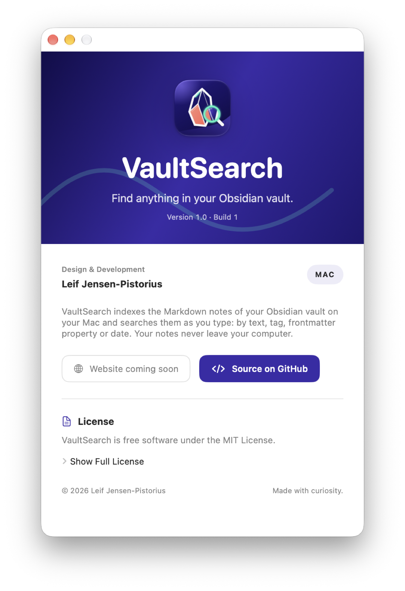

# VaultSearch Developer Guide

This guide explains how VaultSearch is built and how to change it. For using the app, see the [User Guide](user-guide.md).

- [Build and run](#build-and-run)
- [Project layout](#project-layout)
- [Architecture](#architecture)
- [Indexing](#indexing)
- [Search](#search)
- [User interface](#user-interface)
- [Export](#export)
- [Localisation](#localisation)
- [Icons](#icons)
- [About window](#about-window)
- [Testing](#testing)
- [Conventions](#conventions)

## Build and run

| | |
|---|---|
| Platform | macOS 15 or later (`MACOSX_DEPLOYMENT_TARGET = 15.0`) |
| Tooling | Xcode 16 or later (uses the `@Entry` macro and String Catalogs) |
| Language | Swift, Swift 5 language mode, SwiftUI with AppKit where needed |
| Dependencies | none (no Swift packages) |
| Sandbox | off: VaultSearch reads any vault folder the user chooses and launches Pandoc and PDF engines with `Process` |

```sh
open VaultSearch.xcodeproj        # then ⌘R
# or from the command line
xcodebuild -project VaultSearch.xcodeproj -scheme VaultSearch -configuration Debug build
```

The `VaultSearch/` folder is a *file system synchronized group*: every file you add there is part of the target automatically. Swift files are compiled; other files (`.css`, `LICENSE`, `.xcstrings`) are copied into the bundle as resources. The project file needs no edits for new files.

## Project layout

```
VaultSearch/
├── VaultSearchApp.swift      App, scenes (main window, Settings, About, Search Syntax) and menu commands
├── AppModel.swift            Shared state, open panels, note actions, export menus, focused values
├── AppSettings.swift         UserDefaults-backed preferences
├── MarkdownFile.swift        One indexed note (path, content, frontmatter, tags, dates, excerpts)
├── SearchService.swift       In-memory index, change detection; VaultScanner (file system + frontmatter)
├── SearchQuery.swift         Query parser, matching and ranking
├── SearchSuggestion.swift    Completions below the search field, German date words
├── ContentView.swift         Main window: sidebar, result list, toolbar, status bar
├── ResultRow.swift           One row of the result list; Highlighter
├── NoteDetailView.swift      Preview with find bar; MarkdownPreview; FlowLayout
├── DateFilterView.swift      Sheet for custom date filters
├── SearchSyntaxView.swift    Help window
├── SettingsView.swift        Settings window (General and Export tabs)
├── Export/
│   ├── ExportFormat.swift        Formats and errors
│   ├── ExportService.swift       Save panels, running exports, templates, alerts
│   ├── DocumentConverter.swift   Pandoc and macOS conversion pipelines
│   ├── ExternalTools.swift       Finding Pandoc and PDF engines; ProcessRunner
│   ├── ObsidianMarkdown.swift    Obsidian → portable Markdown, match marking, Markdown → HTML
│   ├── ResultListExport.swift    Markdown document for result lists
│   └── ExportStyle.css           Default stylesheet (bundle resource)
├── About/
│   ├── AppAboutView.swift        Generic About view
│   ├── VaultSearchAboutView.swift  VaultSearch configuration
│   └── LICENSE                   Shown in the About window (bundle resource)
├── Localizable.xcstrings     English source strings and German translations
└── Assets.xcassets           App icon and accent colour
Design/
├── AppIcon.svg               Master icon
├── export_icon.sh            Renders the icon into all formats and the asset catalog
└── Export/                   Generated icon files (SVG, PDF, PNG, ICNS, ICO)
VaultSearchTests/             Unit tests (Swift Testing), hosted by the app
docs/
├── user-guide.md, benutzerhandbuch.md, development.md
├── demo-vault/               Sample vault used for screenshots and trying the app
└── images/                   Screenshots (en/, de/) and capture-screenshots.sh
```

## Architecture

```
VaultSearchApp
 └─ AppModel (@MainActor, one per app)
     ├─ AppSettings        @Published preferences, persisted in UserDefaults
     ├─ SearchService      index + change detection ──► VaultScanner (off the main actor)
     └─ ExportService      tools, templates, exports ──► DocumentConverter ──► Pandoc / AppKit
```

- `AppModel` owns the three objects and injects each of them as an `environmentObject` into the main window and the Settings window. Nested `ObservableObject`s do not propagate changes, which is why views observe `AppSettings`, `SearchService` and `ExportService` directly.
- `AppModel` observes `vaultPath`, `excludedFolders` and `exportFolder` with Combine and calls `SearchService.configure`. The export folder is always added to the excluded folders.
- **Menu commands and windows.** Menu commands (`VaultSearchCommands`) reach the frontmost window through focused scene values declared in `AppModel.swift`:

  | Focused value | Published by | Used for |
  |---|---|---|
  | `selectedNote` | `ContentView` | Note menu |
  | `focusSearch` | `ContentView` | ⌘F |
  | `searchResults` | `ContentView` | results export (`ResultsSnapshot`) |
  | `noteFind` | `NoteDetailView` | ⌥⌘F, ⌘G, ⇧⌘G |

- **Note actions.** `NoteActions` collects these actions: open in Obsidian, open with the default app, Finder, and copy link or path. Menus, context menus and toolbars all call it.

## Indexing

`VaultScanner` is a nonisolated `enum` that does all file system work. `SearchService` (main actor) calls it through `Task.detached`.

1. **Enumerate.** `entries(in:excluded:)` walks the vault with `.skipsHiddenFiles` and skips excluded folders. A folder is excluded if its path relative to the vault, its absolute path or its name is in the set. It returns all `.md` files with their creation and modification dates.
2. **Parse.** `index(vaultURL:excluded:progress:)` reads every file and parses it with `parse(_:)`. This is a small YAML subset reader: `key: value`, `key: [a, b]` and `- item` lists. Tags come from the `tags` key, without a leading `#` and deduplicated. The body without frontmatter becomes `MarkdownFile.content`.
3. **Publish.** `apply(_:)` publishes the result and derives:
   - `recentFiles`: the 100 most recently modified notes,
   - `knownTags`: sorted by frequency,
   - `knownProperties`: the top 20 keys,
   - `generation`: incremented on every run, so views re-run their search.
4. **Watch for changes.** A `Signature` (file count, newest modification date, hash of all paths) is compared every 30 seconds and on app activation. Only a difference triggers a full re-index.

The index lives in memory only. Search results are computed from `files` on a detached task (`SearchService.results(for:)`).

## Search

`SearchQuery` turns the search field text into terms and ranks the matches.

**Tokenising** (`tokenize`):

- Split on whitespace outside quotes; quotes are removed, so `"a b"` becomes one token.
- Multi-word relative dates are joined: after `created:last` / `erstellt:letzte`, following numbers and unit words are appended.

**Groups.** Tokens are split into OR groups at `OR`, `ODER` or `|`. `AND`, `UND` and `&` are dropped. A bare `key:` (still being typed) is ignored. A note matches if **any** group matches, and a group matches if **all** of its terms match.

**Terms** (`Term`):

| Term | Matches |
|---|---|
| `.text` | `localizedStandardContains` on title or content (case- and diacritic-insensitive) |
| `.tag` | `tagScore(tag:query:) > 0` for any tag |
| `.contentTag` | `[[name]]`, or the regex from `inlineTagPattern` (`#name`, `#name/…`, `#…/name`) |
| `.property` | case-insensitive key lookup; the value must contain the query |
| `.date` | file creation or modification day compared with a day range |

**Tag score.**

| Score | Meaning | Example |
|---|---|---|
| 3 | exact | `idea` |
| 2 | child | `idea/…` |
| 1 | deeper in the path | `…/idea` or `…/idea/…` |

**Dates.** `dateRange(_:now:calendar:)` resolves the value to a closed range of start-of-day dates. German words are first mapped to English through `germanDateWords`. Explicit dates are recognised by pattern (`yyyy-MM-dd`, `dd.MM.yy`), because `DateFormatter` parses leniently. Operators compare against the range bounds.

**Ranking** (`run(on:)`), in this order:

1. sum of the best tag score per `tag:` term,
2. title contains a text term,
3. newest modification first.

**Suggestions** (`SearchSuggestion.suggestions`) complete the word being typed. They cover tags (at any level, prefix matches first), date presets (English or German, depending on the typed key) and operators including known property keys. `SearchSuggestion.dateKey` / `dateToken` produce tokens in the UI language for the Filter menu and the date sheet.

## User interface

- **Main window** (`ContentView`):
  - `NavigationSplitView` with `.searchable(placement: .sidebar)` and `.searchFocused`, which is why the app needs macOS 15.
  - Search runs in `.task(id: SearchKey)`, debounced by 120 ms. When the selection is no longer among the results, the first hit is selected.
- **Result rows** (`ResultRow`) show `MarkdownFile.snippet(around:)`. It runs on `plain`, a copy of the content with Obsidian syntax removed. Matches are emphasised by `Highlighter`.
- **Preview** (`NoteDetailView`):
  - `MarkdownPreview.lines` renders each source line into its own `AttributedString`. The `LazyVStack` gives each line an id, so `ScrollViewReader` can scroll to a match.
  - Matches are addressed as (line, ordinal) and recomputed with `Highlighter.ranges`. Storing `AttributedString` indices across copies is not reliable, which is why they are recomputed.
  - Text in the find bar replaces the search terms for this note.
  - `MarkdownPreview` is a deliberately small renderer: headings, lists, tasks, quotes, code blocks, rules and inline Markdown.
- **Settings** (`SettingsView`) has two tabs. `TemplateRow` shows each template's purpose and `ExportService.inactiveReason(for:)`.

## Export

### Result lists

`ResultListExport.markdown(…)` builds the document.

| `forVault` | Output |
|---|---|
| `true` | frontmatter, `[[wikilinks]]`, clickable `#tags`; embeds allowed |
| `false` | plain titles; embeds fall back to excerpts |

`ExportService.saveResultsToVault` writes the vault version into the export folder, with a unique file name. With “Open exported files” on, it opens the note through `obsidian://`; otherwise it reveals it in the Finder.

### Conversion pipeline

```
note content ─► ObsidianMarkdown.portable   (links, embeds, comments, callouts)
             ─► ObsidianMarkdown.markMatches (optional ==highlight==; skips code, URLs, link targets)
             ─► DocumentConverter.convert
                  ├─ Pandoc active
                  │    ├─ non-PDF ──► pandoc --to <format> [--reference-doc | --css | --embed-resources]
                  │    └─ PDF ─┬─ engine resolved ──► pandoc --pdf-engine … (auto mode falls back on error)
                  │            └─ no engine / "builtin" ──► pandoc → HTML ──► AppKit PDF
                  └─ no Pandoc ──► ObsidianMarkdown.htmlDocument (+ CSS)
                                   ├─ HTML: written as is
                                   ├─ PDF: NSAttributedString(html) ──► NSPrintOperation (save job)
                                   └─ DOCX/ODT/RTF: NSAttributedString.data(documentType:)
```

Notes on the pipeline:

- **Pandoc input format.** Pandoc reads `markdown+mark+hard_line_breaks-yaml_metadata_block`. Obsidian treats single line breaks as breaks, and a horizontal rule `---` must not start a YAML block.
- **LaTeX engines.** For these, `==mark==` becomes bold, because minimal TeX installations lack `soul.sty`. A margin of `geometry:margin=2.2cm` is set.
- **Missing checkboxes.** AppKit drops `<input>` elements, so Pandoc's task checkboxes are replaced by ☐ / ☑ before AppKit renders the PDF.
- **Word via AppKit.** The Word writer ignores background colours. `emphasizingHighlights` therefore makes highlighted text bold and underlined for DOCX.
- **Running tools.** `ProcessRunner` runs tools with an extended `PATH` (`ExternalTools.searchPaths`), because GUI apps do not inherit the shell `PATH`. It writes stderr to a temporary file so that a full pipe cannot block the process.
- **Finding PDF engines.** `ExternalTools.detect()` looks for engines in the preference order of `knownEngines`.

### Templates

`ExportTemplate` has four slots, stored as paths in `AppSettings.exportTemplates`:

| Slot | Used by |
|---|---|
| `wordReference` | Pandoc `--reference-doc` for DOCX |
| `odtReference` | Pandoc `--reference-doc` for ODT |
| `stylesheet` | Every format without Pandoc; with Pandoc: HTML, EPUB and PDFs made with macOS or an HTML engine |
| `pandocPDFTemplate` | Pandoc `--template`, only used when it fits the engine (`.tex` for LaTeX, `.typ` for Typst, `.html` for HTML engines) |

- **Inactive templates.** `inactiveReason(for:)` explains in the UI when a template has no effect. After an export that could not apply a chosen template, a one-time alert per session tells the user.
- **Defaults.** `createDefaultTemplate` writes Pandoc's `reference.docx` / `reference.odt` (`pandoc -o … --print-default-data-file`), or copies the bundled CSS.

## Localisation

- **Source and catalog.** English is the development language. German lives in `VaultSearch/Localizable.xcstrings`; `de` is listed in the project's `knownRegions`.
- **Writing strings.** SwiftUI literals (`Text("…")`, `Button("…")`, `LocalizedStringKey` parameters) and `String(localized:)` are extracted by the compiler (`SWIFT_EMIT_LOC_STRINGS = YES`). Use `Text(verbatim:)` for text that must not be translated (tags, file names, search terms). A ternary such as `Text(flag ? "a" : "b")` produces a `String` and is **not** localised: write `flag ? Text("a") : Text("b")`.
- **Plurals.** `%lld notes` uses plural variations. Add variations in Xcode's catalog editor when a count appears in a new string.
- **Updating the catalog.** Building in Xcode adds new keys to the catalog automatically; `xcodebuild` does not. To find missing or stale keys after a command-line build, compare the extracted `.stringsdata` files with the catalog:

  ```sh
  python3 - <<'EOF'
  import json, glob
  keys = set()
  for f in glob.glob("DerivedData/**/*.stringsdata", recursive=True):   # adjust the path
      for entries in json.load(open(f)).get("tables", {}).values():
          keys |= {e["key"] for e in entries}
  cat = json.load(open("VaultSearch/Localizable.xcstrings"))["strings"]
  print("missing:", sorted(keys - set(cat)))
  print("stale:", sorted(set(cat) - keys))
  EOF
  ```

- **German search words.** These belong to the search logic, not the catalog:
  - operators (`ODER`, `UND`) and date keys (`erstellt:`, `geändert:`) in `SearchQuery`,
  - date words in `SearchQuery.germanDateWords` and `SearchSuggestion.germanPresets`.

  When you add a relative date, update both and the help text in `SearchSyntaxView`.
- **User documentation** exists in English (`docs/user-guide.md`) and German (`docs/benutzerhandbuch.md`); keep them in sync.

## Icons

`Design/AppIcon.svg` is the only source. It follows the macOS grid: an 824 pt body centred on a 1024 pt canvas. Style: indigo gradient, violet glow, a soft wave, white outlines, a coral “hit” and a mint glow.

```sh
Design/export_icon.sh
```

renders SVG, PDF, PNG (16–1024), ICNS and ICO into `Design/Export/` and replaces the PNGs in `Assets.xcassets/AppIcon.appiconset`. It requires `rsvg-convert` (`brew install librsvg`), `magick` (`brew install imagemagick`) and `iconutil` (part of macOS). The accent colour (`AccentColor.colorset`) is the icon's violet.

## About window

`About/AppAboutView.swift` is a generic SwiftUI About view; it knows nothing about VaultSearch.

- **Configuration.** `VaultSearchAboutView` supplies texts, links and colours.
- **Version.** Version and build come from the bundle.
- **License.** The license text is the bundled `About/LICENSE`.



The window is a SwiftUI `Window` scene (`WindowID.about`) with a hidden title bar. It opens from **VaultSearch ▸ About VaultSearch**.

## Testing

Unit tests live in `VaultSearchTests/` and use **Swift Testing** (`import Testing`, `@Test`, `#expect`). Run them with **Product ▸ Test** (⌘U) or:

```sh
xcodebuild test -project VaultSearch.xcodeproj -scheme VaultSearch -destination 'platform=macOS'
```

The test bundle is hosted by the app (`TEST_HOST`). `AppModel.isRunningTests` keeps the app from indexing the user's vault while tests run. The shared scheme `VaultSearch.xcscheme` contains the test action.

| File | Covers |
|---|---|
| `SearchQueryTests.swift` | tokenising, AND/OR, text matching and ranking, `tagScore`, tag ranking, `contenttag:`, properties, all date forms in English and German, operators |
| `VaultScannerTests.swift` | frontmatter variants, file enumeration with hidden and excluded folders, indexing, change signature |
| `MarkdownFileTests.swift` | Obsidian URI encoding, plain text and excerpts, `Highlighter` |
| `ExportTests.swift` | `ObsidianMarkdown` (portable Markdown, attachments, `markMatches`, HTML), result list documents, file names, tool detection, `ProcessRunner`, built-in conversion of every format, search suggestions |
| `TestSupport.swift` | fixed clock and calendar (`TestClock`), `makeNote`, `TemporaryFolder` |

Guidelines:

- Tests use `TestClock` (UTC, Monday as first weekday, 18 Nov 2026) instead of the real date.
- Tests must not depend on the UI language: do not assert localised strings.
- File system tests work in a `TemporaryFolder` and remove it afterwards.
- Pandoc is not required. Pandoc conversions are not unit-tested because they depend on the installed tools.

Manual checks before a release:

- [ ] Choose a vault; indexing progress; ⌘R reindexes.
- [ ] Text, phrase, `OR`, `tag:` (nested), `contenttag:`, property and date queries, including German words.
- [ ] Preview jumps to the first match; ⌘G / ⇧⌘G and the find bar.
- [ ] Save Results to Vault opens the note in Obsidian.
- [ ] Each export format with and without Pandoc, with highlighting on and off, and with templates.
- [ ] German UI: start with `-AppleLanguages "(de)"`.

### Screenshots and demo vault

The screenshots in the docs are taken with the sample vault in `docs/demo-vault/` (no personal notes). `docs/images/capture-screenshots.sh` takes all of them in English and German; see [`docs/images/README.md`](images/README.md).

## Conventions

- **Language.** The interface follows the macOS Human Interface Guidelines: system controls, menus with standard shortcuts, `ContentUnavailableView` for empty states, `.help` tooltips and accessibility labels on icon-only buttons. In German, follow Apple's terminology (“Im Finder anzeigen”, “Sichern”), with a space before an ellipsis (“Auswählen …”).
- **Code.** The main actor owns UI state. Blocking work (file system, `Process`) runs in `Task.detached` and returns plain values.
- **Settings.** New preferences go into `AppSettings` as `@Published` with a `didSet` that writes to `UserDefaults`; booleans default through `defaults.object(forKey:) as? Bool ?? default`.
- **Documentation.** When behaviour changes, update both user guides and, for search syntax, `SearchSyntaxView`.
