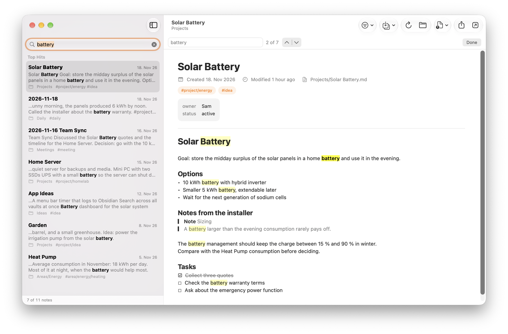
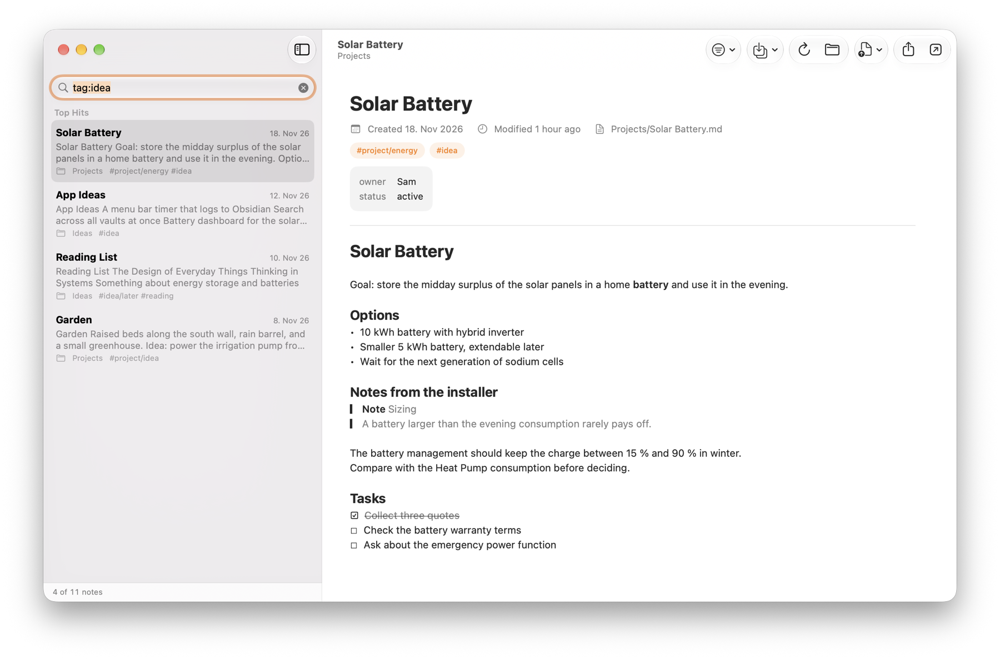
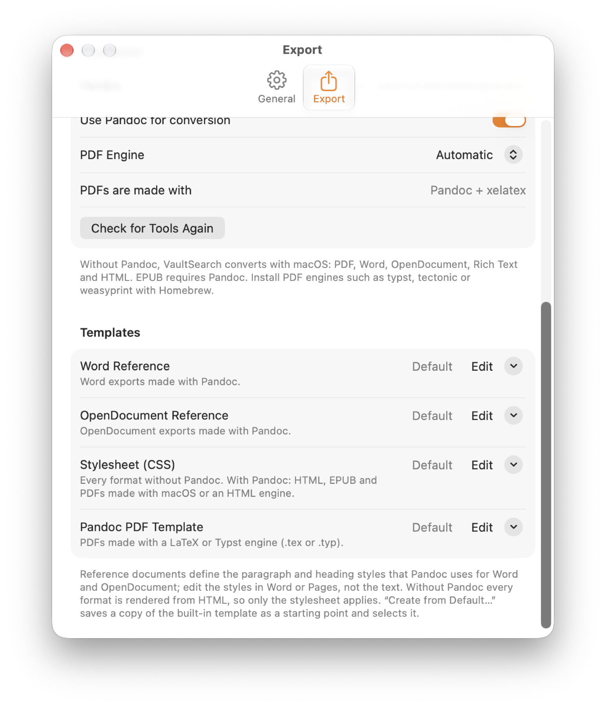
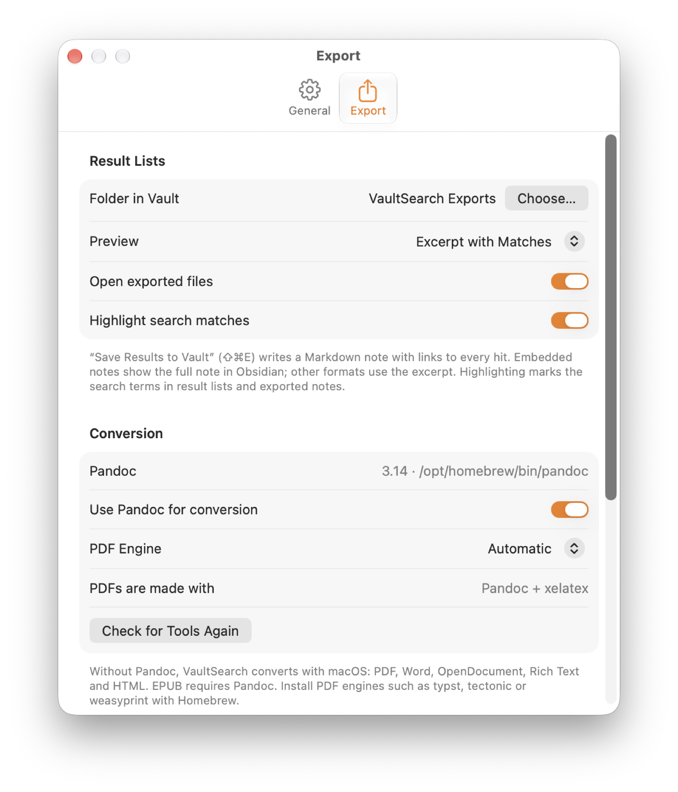

# VaultSearch User Guide

*Deutsch: [Benutzerhandbuch](benutzerhandbuch.md)*

VaultSearch searches the Markdown notes of an Obsidian vault as you type and exports what it finds. This guide covers everything the app can do.

- [Getting started](#getting-started)
- [The window](#the-window)
- [Search syntax](#search-syntax)
- [Finding the match inside a note](#finding-the-match-inside-a-note)
- [Working with notes](#working-with-notes)
- [Export](#export)
- [Settings](#settings)
- [Keyboard shortcuts](#keyboard-shortcuts)
- [Troubleshooting](#troubleshooting)
- [Privacy](#privacy)

## Getting started

1. Open VaultSearch.
2. Click **Choose Vault…** and select the folder of your Obsidian vault. You can change it later with **File ▸ Choose Vault…** (⌘O) or in Settings.
3. VaultSearch reads all notes. On large vaults this takes a few seconds; the progress shows in the sidebar.
4. Start typing.

VaultSearch keeps the index up to date on its own. It checks for changes every 30 seconds and whenever you switch back to the app. **View ▸ Reindex Vault** (⌘R) reads everything again.

The following are skipped:

- hidden folders such as `.obsidian` and `.trash`,
- the folders you exclude in Settings,
- the export folder for result lists.

## The window



| Area | What it shows |
|---|---|
| **Search field** (top of the sidebar) | Your query. ⌘F jumps to it from anywhere. |
| **Result list** | Matching notes: title, date, folder, tags and the passage containing the match. With an empty search field it shows the 100 most recently modified notes. |
| **Status line** (below the list) | Number of hits, indexing or export progress. |
| **Preview** (right) | The selected note with its metadata, tags and properties. Search terms are highlighted. |
| **Toolbar** | Filter menu, export menu, reindex; above the preview: Show in Finder, Export Note, Share, Open in Obsidian. |

Results are ranked in this order:

1. closeness of tag matches (see `tag:` below),
2. notes whose title contains a search word,
3. most recently modified.

Press ↩ in the search field to select the first hit. Use the arrow keys to move through the list, and double-click or press ⌘↩ to open the note in Obsidian.

While you type, the search field suggests operators, your tags, your frontmatter properties and date phrases. Pick a suggestion to complete it.

## Search syntax

All text comparisons ignore case and accents, so `cafe` finds “Café”.

### Text

| Query | Finds notes … |
|---|---|
| `budget` | whose title or text contains “budget” |
| `budget meeting` | containing **both** words, anywhere |
| `"budget meeting"` | containing the exact phrase |

Plain text does **not** search tags. Use `tag:` for that, or combine both with `OR`.

### AND and OR

Terms separated by spaces must **all** match. `OR` separates alternatives. It works the same way as in Obsidian:

```
tag:project budget OR tag:idea
```

means *(tagged project AND containing budget) OR tagged idea*.

- `AND` may be written explicitly, but it is the default anyway.
- German operators work too: `UND`, `ODER`.
- Operators must be written in **upper case**. A lower-case `or` / `oder` is an ordinary search word.

### Tags

Tags come from the `tags` field in the frontmatter, as a list (`- idea`) or inline (`tags: [idea, project]`).

| Query | Finds |
|---|---|
| `tag:idea` | the tag at any level of the hierarchy |
| `tag:project/idea` | that path, also deeper (`area/project/idea`) |



Matches are ranked by closeness:

1. `idea`, the tag itself
2. `idea/later`, a child of it
3. `project/idea`, `area/project/idea`, the tag deeper in the hierarchy

`tag:` compares whole levels, so `tag:idea` does not find `ideas`. A leading `#` is optional.

Tags written in the note text (`#idea`) are found with `contenttag:`:

| Query | Finds in the text |
|---|---|
| `contenttag:idea` | `#idea`, `#idea/later`, `#project/idea` or a link `[[idea]]`, but not `#ideas` |

### Properties

`key:value` finds notes whose frontmatter property *key* contains *value*. The key ignores case, and the note must have the property.

```
status:active
importance:high
source:podcast
```

### Dates

`created:` refers to the file's creation date and `modified:` to its last change. In German you can write `erstellt:` and `geändert:` (or `geaendert:`).

| Value | Meaning |
|---|---|
| `2025-04-28`, `28.04.25`, `28.04.2025` | that day |
| `today`, `yesterday` | |
| `this week`, `this month`, `this year` | from the start of the period until today |
| `last week`, `last month`, `last year` | the previous calendar week, month or year |
| `last 7 days`, `last 2 weeks`, `last 3 months`, `last 1 year` | a rolling period ending today |

German phrases are accepted as well: `heute`, `gestern`, `diese Woche`, `dieser Monat`, `dieses Jahr`, `letzte Woche`, `letzter Monat`, `letztes Jahr`, `letzte 7 Tage`.

Put an operator in front of a date for open ranges: `>=`, `>`, `<=`, `<`.

```
modified:>=2025-04-01 modified:<=2025-04-30
erstellt:letzte 30 Tage tag:idea
```

The **Filter** menu in the toolbar adds common date filters and your most-used tags with one click. **Custom Date Range…** builds a date filter with a calendar. When the app runs in German, these insert the German words.

**Help ▸ Search Syntax** (⌘?) shows a short reference inside the app.

## Finding the match inside a note

When you select a note, the preview jumps to the first match and shows a find bar above the note:

- **3 of 12** shows which match is current. The current match is highlighted in the system find colour, the others in a lighter shade.
- Press **↩** (or ⌘G) for the next match and **⇧↩** (or ⇧⌘G) for the previous one. You can also use the arrow buttons.
- Type into the find bar to search for something else inside this note only (**Edit ▸ Find in Note**, ⌥⌘F). Clear the field to return to the search terms.
- **Done** or Esc closes the find bar.

## Working with notes

The **Note** menu, the context menu of the result list and the toolbar of the preview offer:

| Command | Shortcut |
|---|---|
| Open in Obsidian | ⌘↩ or double-click |
| Open with Default App | ⌥⌘↩ |
| Show in Finder | ⌥⌘R |
| Copy Obsidian Link (`obsidian://…`) | ⇧⌘C |
| Copy Path | ⌥⇧⌘C |
| Export Note As ▸ … | |
| Share | |

Clicking a tag in the preview searches for that tag.

## Export

### Save results to the vault

**File ▸ Save Results to Vault** (⇧⌘E) writes the current result list as a Markdown note into the export folder of your vault. The default folder is `VaultSearch Exports`.

The note contains:

- frontmatter (query, date, number of hits and the tag `#vaultsearch`),
- a heading,
- for each hit: a link `[[…]]`, folder, date and tags, plus a preview.

Choose the preview in Settings ▸ Export:

| Preview | Shows |
|---|---|
| Excerpt with Matches | the passage around the match; with highlighting on, the search words are marked `==like this==` |
| Embedded Note (Obsidian) | `![[note]]`; Obsidian shows the whole note inline |
| Links Only | just the links |

With **Open exported files** on, the new note opens in Obsidian. The export folder itself is never searched, so earlier exports do not show up as hits.

### Export as a file

**File ▸ Export Results As ▸ …** exports the result list, and **Export Note As ▸ …** exports the selected note. Choose a format and a location.

| Format | With Pandoc | Without Pandoc |
|---|---|---|
| PDF | ✓ via the chosen PDF engine | ✓ |
| Word (.docx) | ✓ | ✓ |
| OpenDocument (.odt) | ✓ | ✓ |
| Rich Text (.rtf) | ✓ | ✓ |
| Web Page (.html) | ✓ with embedded images | ✓ |
| EPUB | ✓ | – |
| Markdown | ✓ original file | ✓ original file |

Before converting, VaultSearch turns Obsidian syntax into portable Markdown:

- `[[links]]` become text,
- `![[image.png]]` is looked up anywhere in the vault and embedded,
- `%%comments%%` are removed,
- callouts become bold labels,
- `==highlights==` are kept.

**Highlight search matches** (on by default) marks the current search terms in exported notes and result lists. When you export from the preview while searching inside the note, the find-bar text is marked. Code, link targets, URLs and `[[links]]` are never changed.

How highlighting looks per format:

- **HTML, PDF via macOS, ODT, RTF, EPUB:** coloured background.
- **Word via Pandoc:** Word highlighting.
- **Word via macOS:** bold and underlined, because macOS cannot write background colours to Word files.
- **PDF via LaTeX:** bold.

### Pandoc or macOS?

Without Pandoc, VaultSearch renders the note as HTML with the stylesheet and lets macOS produce the file. This works for everything except EPUB.

With Pandoc installed and **Use Pandoc for conversion** on, Pandoc does the conversion. It gives better Word and OpenDocument files, supports templates, and can typeset PDFs with LaTeX, Typst or an HTML engine.

**PDF Engine** in Settings:

- **Automatic** picks the first available engine in this order: weasyprint, typst, tectonic, xelatex, lualatex, pdflatex, wkhtmltopdf, prince. If that engine fails, for example because a LaTeX package is missing, VaultSearch quietly falls back to Pandoc + macOS.
- **macOS (no Pandoc)** lets Pandoc produce HTML and macOS turn it into a PDF.
- **A specific engine** is always used. Its errors are reported instead of falling back.

Settings shows which route **PDFs are made with**.

### Templates

Which template applies depends on the route:

| Export | Uses |
|---|---|
| any format **without** Pandoc | Stylesheet (CSS) |
| Pandoc → Word | Word reference document |
| Pandoc → OpenDocument | OpenDocument reference document |
| Pandoc → HTML, EPUB | Stylesheet |
| Pandoc → PDF via macOS or an HTML engine (prince, weasyprint) | Stylesheet |
| Pandoc → PDF via LaTeX or Typst | Pandoc PDF template (`.tex` / `.typ`) |



Settings ▸ Export ▸ Templates shows under each template where it applies. If a template has no effect with your current settings, the reason appears in orange, for example *Not used: Pandoc is turned off*. If you export with a template that cannot be applied, VaultSearch tells you once per session.

The **Edit** menu of each template offers:

- **Choose File…** to use your own file.
- **Create from Default…** to save a copy of the built-in template as a starting point and select it:
  - **Word / OpenDocument reference:** Pandoc's default reference document (needs Pandoc). Open it in Word or Pages and change the **styles** (Normal, Heading 1, …), not the text. Pandoc copies these styles into every export.
  - **Stylesheet:** a copy of the built-in CSS in the VaultSearch colours.
- **Show in Finder**.
- **×** returns to the built-in default.

Without Pandoc, Word files are made from HTML, so fonts, sizes and colours for Word come from the stylesheet. macOS applies only part of the CSS there; background colours, for example, are not supported.

## Settings

Open with **VaultSearch ▸ Settings…** (⌘,).

**General**

- **Vault: Folder**: the vault to search. The folder name must match the vault name in Obsidian for “Open in Obsidian” to work.
- **Index**: number of notes and time of the last update; **Reindex Now**.
- **Excluded Folders**: notes in these folders are not searched. Add with **Add Folder…**, remove with ⊖.

**Export**



- **Result Lists**
  - **Folder in Vault**: where result lists are saved.
  - **Preview**: what each hit shows in a result list.
  - **Open exported files**: open each export when it is done.
  - **Highlight search matches**: mark the search terms in exports.
- **Conversion**
  - **Pandoc**: whether Pandoc was found. If not, **Copy Install Command** copies `brew install pandoc`.
  - **Use Pandoc for conversion**.
  - **PDF Engine** and **PDFs are made with**.
  - **Check for Tools Again**: search again after installing Pandoc or an engine.
- **Templates**: see [Templates](#templates).

## Keyboard shortcuts

| Shortcut | Command |
|---|---|
| ⌘F | Search Vault (focus the search field) |
| ↩ in the search field | Select the first hit |
| ⌥⌘F | Find in Note |
| ⌘G / ⇧⌘G | Next / previous match in the note |
| ⌘↩ | Open in Obsidian |
| ⌥⌘↩ | Open with Default App |
| ⌥⌘R | Show in Finder |
| ⇧⌘C | Copy Obsidian Link |
| ⌥⇧⌘C | Copy Path |
| ⇧⌘E | Save Results to Vault |
| ⌘O | Choose Vault… |
| ⌘R | Reindex Vault |
| ⌃⌘S | Show / hide sidebar |
| ⌘, | Settings |
| ⌘? | Search Syntax |

## Troubleshooting

**“Open in Obsidian” opens the wrong vault or nothing.**
VaultSearch uses the folder name as the vault name. Make sure the vault in Obsidian has the same name as its folder.

**A recently created note is missing.**
The index updates every 30 seconds and when you return to the app. Press ⌘R to reindex immediately.

**Pandoc is installed but “Not installed” is shown.**
Apps do not see your shell's `PATH`. VaultSearch looks in `/opt/homebrew/bin`, `/usr/local/bin`, `/Library/TeX/texbin`, `~/.local/bin` and `~/.cargo/bin`. Install Pandoc with Homebrew or link it into one of these folders, then press **Check for Tools Again**.

**PDF export via LaTeX fails with “File `….sty' not found”.**
Your TeX installation lacks a package. This is common with BasicTeX. Install the package with `sudo tlmgr install <name>`, or choose **Automatic** or another engine. With **Automatic**, VaultSearch falls back to Pandoc + macOS on its own.

**PDFs from Prince have a logo on the first page.**
That is the watermark of Prince's free edition. Choose another engine.

**My Word template is ignored.**
Word reference documents only apply when Pandoc converts. Check Settings ▸ Export ▸ Templates for an orange hint.

**The Dock still shows an old icon.**
macOS caches app icons. Moving the app to another folder or restarting the Dock (`killall Dock`) refreshes it.

## Privacy

VaultSearch works entirely on your Mac:

- It reads your vault and keeps the index in memory.
- It sends nothing over the network.
- Pandoc and PDF engines run locally.
- Settings are stored in the app's preferences (`com.leifjp.VaultSearch`).
